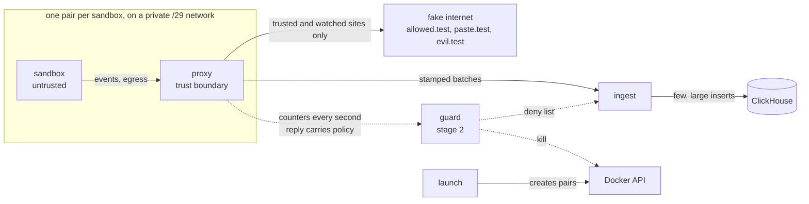

# tiny-sandbox-infra

A local, reproducible demo of control-plane infrastructure for running untrusted sandboxes for many tiny tenants. It has one idea: a guard that can throttle, cut off or kill a misbehaving sandbox within seconds, and a replay harness that A/B tests guard rules against recorded traffic before they are allowed to enforce.

Design notes: _link to come_

**Status: stage 1 of 3.** The trust boundary and the data path are built and tested: sandbox, proxy, ingest, ClickHouse and the launcher. The guard (stage 2) and the recorder and A/B replay (stage 3) are not built yet. Everything described below exists and runs; anything that does not is marked as planned.

## Quickstart

Needs Docker Engine 28 or newer with Compose. Go is only needed to run the tests.

```
make up      # build the image, start ClickHouse, ingest and the fake internet
make demo    # start 17 sandboxes across 15 tenants, run for a minute, show the result
```

`make down` removes everything, including the networks.

## Architecture



Everything is one binary, `tsi`, with one role per subcommand.

| Role | What it does |
|---|---|
| `sandbox` | Simulates untrusted code. Behaviours: `normal`, `bursty`, `flood`, `exfil`, `baddest`, `rejectstorm`. Each is normal until its start offset. |
| `proxy` | One per sandbox. Event gateway and egress proxy. Nothing the sandbox says about itself is believed past this point. |
| `ingest` | Takes stamped batches from proxies and writes few, large inserts (flush on rows or on time). |
| `launch` | Reads a scenario file and creates the pairs and their networks through the Docker API. |
| `fakenet` | The pretend internet: one server that answers for every host name. |
| `guard`, `ab` | Planned for stages 2 and 3. |

### What the proxy enforces

**Event gateway.** For every batch: overwrite `tenant_id` and `sandbox_id` with the values the proxy was started with, assign `event_id` (UUIDv7), clamp `event_time` to now plus or minus one hour, refuse unknown types and oversized payloads, apply a token bucket, then buffer toward ingest. The buffer is bounded in events and in bytes: when it is full the gateway answers 429 and gives the tokens back.

**Egress proxy.** A forward proxy for HTTP and HTTPS (CONNECT). Every domain has a site class, set in the scenario file:

| Class | Effect |
|---|---|
| `trusted` | Allowed. |
| `watched` | Allowed, and its bytes are counted separately. For sites that are legitimate but can be used to move data out. |
| `bad` | Blocked, and every attempt is counted. |
| unlisted | Blocked. Default deny. |

Bytes means everything the sandbox sends: the request line, the headers and the body, plus the reply body. Host names are matched without regard to case or a trailing dot.

**Reason codes.** Every refusal carries a machine-readable reason, so a well-behaved producer can fix itself instead of retrying forever.

| Reason | Status | Meaning |
|---|---|---|
| `malformed` | 400 | Body is not valid JSON. Ingest also answers this for an event no proxy would send. |
| `body_too_large` | 413 | Event request over 1 MiB, or an outbound upload over 8 MiB. |
| `batch_too_large` | 413 | More events than the token bucket can ever hold. Retrying will not help. |
| `unknown_type` | 200, per event | Event type is not in the schema. |
| `oversized_event` | 200, per event | Payload over 4 KiB. |
| `rate_limited` | 429 | Token bucket is empty. `Retry-After` says how long to wait. The reply also lists events that would be refused anyway. |
| `buffer_full` | 429 | Ingest is slow. `Retry-After` is set. |
| `site_bad`, `site_unlisted` | 403 | Egress refused by site class. |
| `forbidden_peer` | 403 | The caller is not this proxy's sandbox. |
| `upstream_error` | 502 | The remote host could not be reached. |

### Network layout

The isolation of a sandbox is decided by how its network is built, not by code that could have a bug.

- Each sandbox gets its own bridge network with an explicit /29 subnet. It is `internal` (no route out, no NAT) with gateway mode `isolated` (no address on the Docker host).
- The sandbox joins only that network. It has one address, one link-scope route and no default route.
- Its proxy joins that network plus `tsi-control` (toward ingest) and `tsi-internet` (toward the fake hosts). It listens only on its sandbox-side address.
- ClickHouse is on `tsi-storage`, which only ingest shares. A compromised proxy cannot reach it.
- All networks are internal. Nothing in the demo has a route to the real internet.

If a proxy dies, its sandbox's only link has nothing behind it: fail closed, by topology.

## Sample output

`make demo`, after one minute. First what each tenant stored, from ClickHouse:

```
    ┌─tenant_id─┬─sandboxes─┬─events─┬─payload_bytes─┐
 1. │ t01       │         1 │   1258 │ 147.42 KiB    │   normal
10. │ t10       │         1 │   2216 │ 259.69 KiB    │   bursty, paid
11. │ t11       │         1 │   5198 │ 609.14 KiB    │   flood from 10 s
12. │ t12       │         1 │   1214 │ 142.27 KiB    │   exfil from 20 s
13. │ t13       │         1 │   1210 │ 141.80 KiB    │   baddest from 30 s
15. │ t15       │         3 │   7767 │ 910.20 KiB    │   split flood from 40 s
    └───────────┴───────────┴────────┴───────────────┘
```

(Rows and fields trimmed and annotated by hand.) Every sandbox claims to be tenant `someone-else` in every event. No such tenant appears.

Then what each proxy counted:

```
"sandbox_id":"s01","events_accepted":1198,"dropped":0,"rejects":{},"egress_by_class":{"trusted":2940},"blocked":{}
"sandbox_id":"s11","events_accepted":5198,"dropped":0,"rejects":{"rate_limited":95000},"egress_by_class":{"trusted":2940},"blocked":{}
"sandbox_id":"s12","events_accepted":1198,"dropped":0,"rejects":{},"egress_by_class":{"trusted":2940,"watched":41953120},"blocked":{}
"sandbox_id":"s13","events_accepted":1198,"dropped":0,"rejects":{},"egress_by_class":{"trusted":2940},"blocked":{"site_bad":60}
"sandbox_id":"s15","events_accepted":2598,"dropped":0,"rejects":{},"egress_by_class":{"trusted":2940},"blocked":{}
```

This is the picture stage 1 leaves, and the reason stage 2 exists:

- The flood (`s11`) is capped at the static limit, but it keeps going forever.
- The exfil (`s12`) moved 40 MB to a watched site and nothing stopped it.
- The split flood (`s15` to `s17`) looks harmless per sandbox. Only a per-tenant view sees it.

The live timeline (stage 2) and the A/B report (stage 3) will be pasted here when they exist.

## Tests

`make test` needs no Docker. It proves, among other things:

- a spoofed `tenant_id` is overwritten, all the way to what ingest receives
- unknown and oversized events are rejected with reason codes and counted
- the token bucket answers 429 with `Retry-After`, and accepts again after that wait
- `event_time` is clamped
- unlisted and `bad` domains are blocked, including an IP literal and a look-alike name
- a slow ingest produces 429s and the buffer never passes its limit, and nothing accepted is lost when ingest recovers
- a refused request costs no tokens, and a retried batch does not count its bad events twice
- data sent in a URL or a header is counted, and an upload over the limit is refused before any of it leaves
- an event the store could never take is refused by ingest and never enters the shared queue
- stopping a proxy or ingest writes out what was already acknowledged
- a well-behaved sandbox backs off on 429 and a flood does not

`make test-integration` needs a Docker engine. It starts real pairs and proves:

- a sandbox can reach its own proxy and nothing else: not ingest, ClickHouse, the fake internet, another sandbox's proxy, its own proxy's other interfaces, a public address or any DNS name. A control probe from a proxy's position reaches the same targets, so the failures are the network saying no.
- a sandbox whose proxy dies can reach nothing at all

## Measured footprint

On an Apple Silicon laptop, default scenario, one minute in: 37 containers, **410 to 670 MiB** of memory in total over two runs, and about a quarter of one core. The spread is ClickHouse, which is capped at 1 GiB and used 130 to 400 MiB. Each proxy and sandbox used under 10 MiB. The image is 17 MB.

Starting 17 pairs takes about 4 seconds. The network approach was also run with 20 sandboxes (40 containers, 20 networks): 11 seconds to start, which includes removing the previous run, and 8 to remove.

These are relative numbers from one laptop, not capacity claims. x86 has not been measured yet.

## Limitations

- **Docker containers are not a security boundary.** The sandbox containers run with all capabilities dropped, a read-only root and a memory limit, and that is still not enough for hostile code. A real system needs gVisor or microVMs.
- **The Docker socket is a local shortcut.** `launch` mounts it, which is root on the host. In production the launcher would call a scheduler API with a narrow, audited permission, and nothing in the data path would hold it.
- **Numbers are relative comparisons on a laptop**, not capacity claims.
- **No authentication between components** (a stated non-goal). Ingest believes any caller on the control network. In production each proxy would have an identity and ingest would check that a batch's tenant matches it.
- **Delivery is at least once.** A lost reply makes the proxy resend a batch. Duplicates share an `event_id`; the demo does not remove them.
- **Buffers are in memory.** A normal stop writes them out first. A crash or a kill loses what a proxy or ingest was still holding, including events already answered with a 200.
- **The live demo never opens an HTTPS tunnel.** The fake hosts speak plain HTTP. CONNECT is covered by a unit test.
- **The egress proxy sees host names and byte counts only.** It does not inspect content, and for a tunnel it trusts the host name in the CONNECT line.
- **Replay is open loop** (stage 3): it cannot model how an action would have changed later traffic.

## What changes at real scale

| In the demo | In production |
|---|---|
| Docker containers | gVisor or microVMs, one network namespace and tap device per sandbox |
| One Docker bridge network per sandbox | The same shape, built by the VM manager. Bridges and firewall rules per sandbox do not scale to thousands. |
| A token bucket in each proxy | Quota leases: the proxy borrows rate from a per-tenant budget, so a tenant's total is enforced across sandboxes |
| One guard (stage 2) | A guard sharded by tenant |
| Kill | A quarantine pool, so a suspect sandbox can be studied before it is destroyed |
| An in-memory buffer between proxy and ingest | A durable queue |
| One of everything | Cells, so one bad deployment or one bad rule reaches a bounded share of tenants |
| Docker socket in `launch` | A scheduler API with a narrow permission |

## Repository layout

```
cmd/tsi/             the one binary: picks a role from the first argument
internal/event/      event schema, checks, reason codes, bounded queue
internal/proxy/      event gateway, token bucket, egress proxy
internal/ingest/     batching writer
internal/chstore/    the only code that talks to ClickHouse
internal/launch/     pairs and networks through the Docker API
internal/scenario/   the scenario file
internal/sandbox/    the simulated untrusted code
clickhouse/          schema, memory cap, usage query
scenarios/           default.yaml: the 17-sandbox demo
docs/                the original brief (SPEC.md) and the plan
DECISIONS.md         every real tradeoff: chosen, rejected, why
```

## Make targets

| Target | What it does |
|---|---|
| `make up` | Build the image, start ClickHouse, ingest and the fake internet |
| `make demo` | `up`, start the pairs, run for a minute, print usage and counters |
| `make down` | Remove the pairs, their networks and everything else |
| `make usage` | Per-tenant usage from ClickHouse |
| `make counters` | What each proxy has counted |
| `make test` | Unit tests, no Docker needed |
| `make test-integration` | Isolation tests against a real Docker engine |
| `make lint` | `go vet` and `golangci-lint` |

MIT licence.
