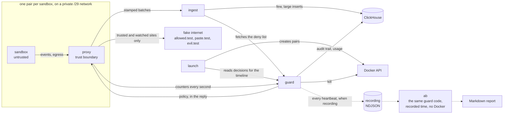

# tiny-sandbox-infra

A local, reproducible demo of control-plane infrastructure for running untrusted sandboxes for many tiny tenants. It has one idea: a guard that can throttle, cut off or kill a misbehaving sandbox within seconds, and a replay harness that A/B tests guard rules against recorded traffic before they are allowed to enforce.

Design notes: _link to come_

**Status: all three stages are built.** The trust boundary and the data path, the guard, and the recorder with the A/B replay. Everything described below exists and runs.

## Quickstart

Needs Docker Engine 28 or newer with Compose. Go is only needed to run the tests.

```
make up      # build the image, start ClickHouse, ingest, the guard and the fake internet
make demo    # start 17 sandboxes across 15 tenants and watch the guard for 70 seconds
```

`make down` removes everything, including the networks.

`make ab` needs only Go, no Docker: it replays the committed recordings through two rule sets and prints the report shown below.

## What the demo shows

Seven of the 17 sandboxes start to misbehave at different times. This is the timeline `make demo` prints:

```
  time   sbx  tnt  tier  what happened
  12.4s  s11  t11  free  flood begins
  14.3s  s11  t11  free  detected  (rule flood-seen)
  15.3s  s11  t11  free  throttled to 10 events/s  (rule flood)  2.9 s after onset
  18.3s  s11  t11  free  would throttle (shadow, nothing changed)  (rule ignores-backpressure)
  21.3s  s11  t11  free  cut off: no events accepted  (rule flood-goes-on)
  22.6s  s12  t12  free  exfil begins
  25.5s  s12  t12  free  egress blocked  (rule exfil)  2.9 s after onset
  28.3s  s11  t11  free  killed  (rule flood-never-stops)
  32.8s  s13  t13  free  baddest begins
  35.7s  s13  t13  free  killed  (rule bad-site)  2.9 s after onset
  38.1s  s14  t14  paid  baddest begins
  40.9s  s14  t14  paid  egress blocked, kill left to a human (paid tenant)  (rule bad-site)  2.9 s after onset
  43.3s  s15  t15  free  flood begins
  43.5s  s16  t15  free  flood begins
  43.7s  s17  t15  free  flood begins
  48.4s  s16  t15  free  throttled to 20 events/s  (rule split-flood)  4.9 s after onset
  48.6s  s17  t15  free  throttled to 20 events/s  (rule split-flood)  4.9 s after onset
  49.2s  s15  t15  free  throttled to 20 events/s  (rule split-flood)  5.9 s after onset

Summary
  s11  flood    contained 2.9 s after onset
  s12  exfil    contained 2.9 s after onset
  s13  baddest  contained 2.9 s after onset
  s14  baddest  contained 2.9 s after onset
  s15  flood    contained 5.9 s after onset
  s16  flood    contained 4.9 s after onset
  s17  flood    contained 4.9 s after onset
  neighbours: 10 well-behaved sandboxes, 0 throttled, blocked or killed
```

What to read from it:

- **The ladder.** `s11` floods at 2,000 events/s. It is noticed, throttled, cut off and finally killed, each step only because the one before did not make it stop.
- **Two controls.** `s12` uploads to a watched site and loses its egress. Its events keep flowing.
- **Tiers.** `s13` and `s14` do the same thing, calling a known bad site. The free one is killed. The paid one has its egress blocked and the kill is left to a human.
- **Two levels.** `s15` to `s17` each stay under the per-sandbox limit. Only their tenant's total gives them away.
- **Neighbours.** The ten well-behaved sandboxes are never touched, including `s10`, which sends legitimate bursts at eight times its normal rate.
- **Shadow mode.** `ignores-backpressure` is a candidate rule. It records what it would have done and changes nothing.

"Contained" is the first enforced action. The times are measured from the moment the behaviour starts, which the launcher knows, to the moment the guard decides. The proxy has the new policy in the same round trip.

The same run, from the audit trail in ClickHouse (`make actions`, some columns trimmed):

```
┌─time─────┬─sandbox_id─┬─tier─┬─rule─────────────────┬─mode────┬─action───────┬─effect───────┬─note───────────────┬─rate─┬─offered─┬─baseline─┬─tenant_offered─┐
│ 18:44:37 │ s11        │ free │ flood-seen           │ enforce │ observe      │ observe      │                    │    0 │    1998 │       20 │           1998 │
│ 18:44:38 │ s11        │ free │ flood                │ enforce │ throttle     │ throttle     │                    │   10 │    2000 │       20 │           2000 │
│ 18:44:41 │ s11        │ free │ ignores-backpressure │ shadow  │ throttle     │              │ shadow             │    0 │    2001 │       20 │           2001 │
│ 18:44:44 │ s11        │ free │ flood-goes-on        │ enforce │ throttle     │ throttle     │                    │    0 │    2000 │       20 │           2000 │
│ 18:44:48 │ s12        │ free │ exfil                │ enforce │ block_egress │ block_egress │                    │    0 │      20 │       20 │             20 │
│ 18:44:51 │ s11        │ free │ flood-never-stops    │ enforce │ kill         │ kill         │                    │    0 │    2003 │       20 │           2003 │
│ 18:44:59 │ s13        │ free │ bad-site             │ enforce │ kill         │ kill         │                    │    0 │      20 │       20 │             20 │
│ 18:45:04 │ s14        │ paid │ bad-site             │ enforce │ kill         │ block_egress │ approval_requested │    0 │      20 │       20 │             20 │
│ 18:45:11 │ s16        │ free │ split-flood          │ enforce │ throttle     │ throttle     │                    │   20 │      90 │       21 │            270 │
│ 18:45:12 │ s17        │ free │ split-flood          │ enforce │ throttle     │ throttle     │                    │   20 │      90 │       21 │            270 │
│ 18:45:12 │ s15        │ free │ split-flood          │ enforce │ throttle     │ throttle     │                    │   20 │      90 │       22 │            270 │
└──────────┴────────────┴──────┴──────────────────────┴─────────┴──────────────┴──────────────┴────────────────────┴──────┴─────────┴──────────┴────────────────┘
```

And cost per tenant, from the usage table (`make usage`, rows trimmed):

```
┌─tenant_id─┬─sandboxes─┬─events─┬─payload────┬─rejected─┬─egress────┬─watched──┬─blocked_calls─┐
│ t01       │         1 │   1458 │ 170.86 KiB │        0 │ 3.54 KiB  │ 0.00 B   │             0 │   normal
│ t10       │         1 │   2538 │ 297.42 KiB │        0 │ 3.45 KiB  │ 0.00 B   │             0 │   bursty, paid
│ t11       │         1 │    598 │ 70.08 KiB  │    31600 │ 1.24 KiB  │ 0.00 B   │             0 │   flood, killed
│ t12       │         1 │   1418 │ 166.17 KiB │        0 │ 3.00 MiB  │ 3.00 MiB │           120 │   exfil, egress blocked
│ t13       │         1 │    658 │ 77.11 KiB  │        0 │ 1.63 KiB  │ 0.00 B   │             6 │   bad site, killed
│ t14       │         1 │   1396 │ 163.59 KiB │        0 │ 1.82 KiB  │ 0.00 B   │            86 │   bad site, paid
│ t15       │         3 │   5337 │ 625.43 KiB │     5058 │ 10.05 KiB │ 0.00 B   │             0 │   split flood, throttled
└───────────┴───────────┴────────┴────────────┴──────────┴───────────┴──────────┴───────────────┘
```

The exfil moved 3 MiB before it was blocked. Without the guard the same sandbox moved 40 MiB in a minute and never stopped. Every sandbox claims to be tenant `someone-else` in every event. No such tenant appears.

## What the A/B replay shows

A rule that is wrong in production throttles paying tenants or misses an attack. So before a rule set is allowed to enforce, it is run against recorded traffic. `make ab` replays the same recording of the demo through two rule sets:

- [`rules/a.yaml`](rules/a.yaml), the one the demo runs: thresholds relative to each sandbox's own baseline, a tenant-level limit, and a `for` of two seconds before it acts.
- [`rules/b.yaml`](rules/b.yaml): fixed limits on each sandbox by itself, acting on the first window that crosses a line.

The end of the report (`make ab`, the full report has one table per rule set as well):

```
## A against B

| | A | B |
|---|---|---|
| s11 flood contained after | 3.0 s | 1.0 s |
| s12 exfil contained after | 3.0 s | 1.0 s |
| s13 baddest contained after | 3.0 s | 1.0 s |
| s14 baddest contained after | 3.0 s | 1.0 s |
| s15 flood contained after | 5.0 s | **never** |
| s16 flood contained after | 5.0 s | **never** |
| s17 flood contained after | 5.0 s | **never** |
| Bad sandboxes contained | 7 of 7 | 4 of 7 |
| Misses | 0 | 3 |
| False positives | 0 | 1 |
| Events passed after onset | 4182 | 7222 |
| Egress before the block | 3077 KiB | 1028 KiB |
| Blast radius cap | not reached | not reached |
```

and from B's own section:

```
- Misses: **3**: s15 (flood), s16 (flood), s17 (flood)
- False positives: **1**: s10 (bursty, paid) throttle by `flood` at 22.9 s
```

**B is faster, and it is wrong twice.** It contains the single flood in one second where A takes three, and it lets a third of the exfil through. It also throttles `s10`, a paying tenant's legitimate burst, and it never sees the split flood, because no sandbox of that tenant crosses a line by itself. Which of the two to run is a judgement. The replay is what turns it from a guess into a table.

The times are whole seconds because a replay knows when a behaviour began only from the start time of the sandbox's proxy, and heartbeats tick from that same moment. The live demo, where the launcher knows the real onset, measured 2.9 s for the same thing.

A second recording, `recordings/mass.ndjson`, is a mass event: five free sandboxes call a bad site at once. Both rule sets answer with a kill, the blast radius cap allows three a minute, and the report says so: `Blast radius cap: **reached**, 2 kills refused`. The two that were refused have their egress blocked.

## Architecture



Everything is one binary, `tsi`, with one role per subcommand.

| Role | What it does |
|---|---|
| `sandbox` | Simulates untrusted code. Behaviours: `normal`, `bursty`, `flood`, `exfil`, `baddest`, `rejectstorm`. Each is normal until its start offset. |
| `proxy` | One per sandbox. Event gateway and egress proxy. Nothing the sandbox says about itself is believed past this point. |
| `ingest` | Takes stamped batches from proxies and writes few, large inserts (flush on rows or on time). Drops the events of sandboxes on the guard's deny list. |
| `guard` | Turns heartbeats into rates, evaluates the rules and applies the ladder. Writes the audit trail and the usage table. |
| `launch` | Reads a scenario file and creates the pairs and their networks through the Docker API. Then prints the timeline. |
| `fakenet` | The pretend internet: one server that answers for every host name. |
| `ab` | Replays a recording through two rule sets and prints a Markdown report. Needs no Docker and no ClickHouse. |

### What the proxy enforces

**Event gateway.** For every batch: overwrite `tenant_id` and `sandbox_id` with the values the proxy was started with, assign `event_id` (UUIDv7), clamp `event_time` to now plus or minus one hour, refuse unknown types and oversized payloads, apply a token bucket, then buffer toward ingest. The buffer is bounded in events and in bytes: when it is full the gateway answers 429 and gives the tokens back.

**Egress proxy.** A forward proxy for HTTP and HTTPS (CONNECT). Every domain has a site class, set in the scenario file:

| Class | Effect |
|---|---|
| `trusted` | Allowed. |
| `watched` | Allowed, and its bytes are counted separately. For sites that are legitimate but can be used to move data out. |
| `bad` | Blocked, and every attempt is counted. |
| unlisted | Blocked. Default deny. |

Bytes means everything the sandbox sends: the request line, the headers and the body, plus the reply body. Host names are matched without regard to case or a trailing dot.

**Heartbeat.** Every second the proxy sends its counters to the guard. They are running totals, so a lost heartbeat loses nothing. The reply is the policy for that sandbox: an event rate and an egress switch. The proxy needs no inbound control port. A policy can only lower the static rate, never raise it.

**Reason codes.** Every refusal carries a machine-readable reason, so a well-behaved producer can fix itself instead of retrying forever.

| Reason | Status | Meaning |
|---|---|---|
| `malformed` | 400 | Body is not valid JSON. Ingest also answers this for an event no proxy would send. |
| `body_too_large` | 413 | Event request over 1 MiB, or an outbound upload over 8 MiB. |
| `batch_too_large` | 413 | More events than the token bucket can ever hold. Retrying will not help. |
| `unknown_type` | 200, per event | Event type is not in the schema. |
| `oversized_event` | 200, per event | Payload over 4 KiB. |
| `rate_limited` | 429 | Token bucket is empty, or the guard has throttled or cut off the sandbox. `Retry-After` says how long to wait. The reply also lists events that would be refused anyway. |
| `buffer_full` | 429 | Ingest is slow. `Retry-After` is set. |
| `site_bad`, `site_unlisted` | 403 | Egress refused by site class. |
| `egress_blocked` | 403 | The guard has blocked this sandbox's egress. |
| `forbidden_peer` | 403 | The caller is not this proxy's sandbox. |
| `upstream_error` | 502 | The remote host could not be reached. |
| `guard_full` | 503 | To a proxy: the guard tracks as many sandboxes as it can. |

### What the guard does

**Windows.** The guard keeps the last three heartbeats of every sandbox, which is two seconds. A rate is the growth between the oldest and the newest divided by the time between them. A sandbox is judged the moment its heartbeat arrives, and the verdict goes back in the reply.

**Two levels.** Every rule runs once per sandbox and can use that sandbox's numbers and its tenant's totals. A rule on a tenant number therefore acts on every sandbox of the tenant.

**Baselines.** Each sandbox has a slow moving average of its own offered rate (about a minute). A tenant's baseline is the sum of its sandboxes' baselines, so a sandbox that starts or leaves moves the tenant's rate and its baseline together. A rule can ask whether something is behaving unlike itself. A baseline does not learn while a rule objects to anything in the tenant, or a flood that lasts long enough would become the new normal. A sandbox's first window is taken as its normal on the same condition. Until it has a baseline, its baseline is zero, so only the fixed part of a rule (`offered_rate > 100.0`) can speak for it.

**Rules** live in YAML, see [`rules/a.yaml`](rules/a.yaml):

```yaml
- name: flood
  expr: offered_rate > 100.0 && offered_rate > 6.0 * baseline_rate   # CEL
  for: 2s          # how long expr must hold
  action: throttle
  rate: 10         # throttle only, and required there: the new events per second
  mode: enforce    # or shadow. Left out, a rule is shadow.
  ttl: 30s         # the action expires this long after the rule last fired
```

A typo in a rule is an error when the guard starts, not a rule that never fires.

**Rule variables.** All are numbers except `tier`. Arithmetic needs a decimal point (`6.0 * baseline_rate`).

| Variable | Meaning |
|---|---|
| `offered_rate` | Events per second the sandbox tried to send: accepted plus refused. |
| `accepted_rate` | Events per second that got through. |
| `reject_ratio` | Share of offered events that were refused, 0 to 1. `buffer_full` does not count: that one is our fault. |
| `egress_bytes_rate` | Bytes per second to allowed sites, all classes. |
| `watched_bytes_rate` | Bytes per second to watched sites. |
| `bad_site_attempts` | Calls to bad sites in the window (a count, not a rate). |
| `baseline_rate` | This sandbox's own normal `offered_rate`. |
| `tenant_offered_rate` | `offered_rate` summed over the tenant's sandboxes. |
| `tenant_baseline_rate` | `baseline_rate` summed over the tenant's sandboxes. |
| `tenant_sandboxes` | How many of the tenant's sandboxes are reporting. |
| `tier` | `"free"` or `"paid"`. |

**The ladder**, cheapest first:

| Action | Effect |
|---|---|
| `observe` | Recorded. Nothing changes. |
| `throttle` | The proxy's token bucket refills at `rate`. Rate zero is the cut-off: no event passes, and ingest drops that sandbox's events too. |
| `block_egress` | The proxy refuses every outbound call. Events are not touched. |
| `kill` | The sandbox and its proxy are stopped through the Docker API. |

Events and egress are separate controls. When several rules hold an action on one sandbox, the strictest wins on each control. Escalation is the same expression with a longer `for`.

**Limits on the guard itself.**

- *Tiers.* Automation never kills a paid tenant's sandbox. The kill becomes `block_egress` and an approval request is logged and written to the audit trail. A tenant the guard has no tier for is treated as paid.
- *Blast radius cap.* At most `max_kills_per_minute` kills. Above that the guard stops killing, logs that a human is needed, and keeps the cheaper actions working. A refused kill becomes `block_egress`, like a paid tenant's, and is tried again once there is room.
- *Shadow mode.* A shadow rule writes one audit row saying what it would have done.

**Audit and usage.** Every decision, enforced or shadow, and every lifted action is a row in `guard_actions`, with the rule, the note and the rule variables at that moment. Every heartbeat is a row in `usage`, with the proxy's running totals and the time that proxy started. `make usage` shows cost per tenant from it: the largest value of each proxy run, added up, so a proxy that restarts and counts from zero again loses nothing.

**Memory.** The guard tracks at most 10,000 sandboxes at once. One that has been silent for a minute, with no action held against it, is forgotten.

**When things fail.**

| Failure | What happens |
|---|---|
| Guard is down | Proxies keep their last policy and their static limits. Ingest keeps its last deny list. Nothing loosens. |
| Guard restarts | It has no memory. Each proxy reports the policy it is enforcing and the guard keeps it for 30 seconds. A sandbox that comes back under a policy gets no baseline from what it is doing now, so a flood that is still going trips its rule again within seconds. |
| A kill fails | The sandbox is already cut off by policy: no events, no egress, and on the deny list. Both containers are tried even if one fails, and while the proxy still sends heartbeats the kill is tried again every 10 seconds. |
| ClickHouse is down | The guard keeps deciding. Audit and usage rows wait in memory, up to a limit, and every decision is also a log line. |
| A proxy dies | Its sandbox has no other link. See below. |

### Recorder and replay

**Recording.** With `TSI_RECORD` set, the guard appends every heartbeat it receives to a file, one JSON value per line, with the time it arrived. The first line is the scenario: the ground truth of who misbehaves, how, and from what offset. A recording is bounded at 64 MiB. The file is written by a goroutine of its own, so a slow disk never holds up the guard. If a write fails, or the disk falls so far behind that a heartbeat would have to wait, the recording has a gap: it stops, and the guard removes the file when it shuts down. The guard goes on either way.

**Shadow while recording.** `make record` adds `compose.record.yaml`, which forces every rule to shadow (`TSI_SHADOW`) and is the only place `recordings/` is mounted into the guard. If rules enforced while recording, a killed sandbox would stop sending and a throttled one would look different, so the traffic would already carry the mark of one rule set and the comparison would favour it. A recording made with rules enforcing says so in its header, and the report warns about it.

**Replay.** `tsi ab --recording R --a rules/a.yaml --b rules/b.yaml` feeds the recorded heartbeats to the same guard code that runs live, once per rule set, with the clock set to each heartbeat's recorded time and a runtime that kills nothing. Expired actions are lifted at every whole second of recorded time. Nothing in it depends on the real time or on map order, so the same recording always gives the same report.

**What the report measures**, per rule set and for each misbehaving sandbox, counted from the moment its behaviour began:

| Column | Meaning |
|---|---|
| First action | The first decision of any kind, `observe` included. |
| Contained | The first heartbeat after onset that the replayed guard answered with a throttle, an egress block or a kill. An action held from before onset counts: it is then also a false positive. |
| Events passed after onset | The events the recorded proxy accepted, cut down to what the replayed policy would have let through in each second. Only the part of each heartbeat's interval after onset counts. |
| Egress before the block | The bytes that left while the replayed policy had egress open, counted the same way. |

plus the misses (never contained), the false positives (a sandbox restricted while it was well behaved), whether the blast radius cap was reached, and any rule that could not be evaluated. A bad sandbox whose behaviour begins after the recording ends is listed as not scored, not as a miss.

**Replay is open loop.** The recorded traffic does not react to what a rule set decides. A sandbox that a rule set kills keeps sending in the recording. A sandbox that backs off when throttled does not back off here. So the times to first action and to containment are exact for the recorded traffic, and the two volume columns are estimates.

`make record NAME=default` makes a new recording from `scenarios/NAME.yaml`. It needs Docker. The guard writes to `recordings/NAME.ndjson.part`, and only a run that completes, with a recording that has no gap, replaces the committed file. If the run fails or is stopped, the pairs are still removed and the guard goes back to enforcing.

### Network layout

The isolation of a sandbox is decided by how its network is built, not by code that could have a bug.

- Each sandbox gets its own bridge network with an explicit /29 subnet. It is `internal` (no route out, no NAT) with gateway mode `isolated` (no address on the Docker host).
- The sandbox joins only that network. It has one address, one link-scope route and no default route.
- Its proxy joins that network plus `tsi-control` (toward ingest and the guard) and `tsi-internet` (toward the fake hosts). It listens only on its sandbox-side address.
- ClickHouse is on `tsi-storage`, which only ingest and the guard share. A compromised proxy cannot reach it.
- All networks are internal. Nothing in the demo has a route to the real internet.

If a proxy dies, its sandbox's only link has nothing behind it: fail closed, by topology.

## Tests

`make test` needs no Docker. It proves, among other things:

- a spoofed `tenant_id` is overwritten, all the way to what ingest receives
- unknown and oversized events are rejected with reason codes and counted
- the token bucket answers 429 with `Retry-After`, and accepts again after that wait
- `event_time` is clamped
- unlisted and `bad` domains are blocked, including an IP literal and a look-alike name
- a slow ingest produces 429s and the buffer never passes its limit, and nothing accepted is lost when ingest recovers
- a refused request costs no tokens, and a retried batch does not count its bad events twice
- data sent in a URL or a header is counted, and an upload over the limit is refused before any of it leaves
- an event the store could never take is refused by ingest and never enters the shared queue
- stopping a proxy or ingest writes out what was already acknowledged
- a well-behaved sandbox backs off on 429 and a flood does not

and for the guard:

- window maths: rates from running totals, a late heartbeat, a counter that went down
- a baseline follows slowly, and not at all while a rule objects
- a tenant that starts four busy sandboxes at once is not taken for a split flood, and a new sandbox cannot dilute one that is under way
- a rule fires only after `for`, stays while it fires, and is lifted one `ttl` later
- a mistake in a rule file is refused when it is loaded, including a throttle without a rate
- the split flood is caught by the tenant's total, and the same sandbox alone is left in peace
- a paid tenant's sandbox is never killed, and neither is one of an unknown tenant
- the blast radius cap stops the third kill, blocks egress in its place, keeps the throttle, and allows the kill a minute later
- two kill rules that fire together kill a sandbox once and use one slot of the cap
- a kill that fails is tried again while the proxy still reports
- the deny list is the killed and the cut off, and ingest drops their events also when the guard is gone
- a proxy keeps its last policy and its static limits when the guard is down
- a restarted guard does not loosen what a proxy enforces, and does not take a flood in progress for normal
- a sandbox that is gone is forgotten, so the limit of 10,000 counts the ones that are there
- the timeline tells "contained" from "acted on before it misbehaved"
- the shipped rule set against the shipped scenario: every bad sandbox contained, no good one touched

and for the recorder and the replay:

- every heartbeat is recorded as it arrived, and a recording that fails or reaches its size limit stops without stopping the guard
- replay is deterministic: the same recording gives the same report, byte for byte
- a live guard that enforces and records, then its recording replayed through the same rules, reach the very same decisions
- the shipped rule sets on the committed recording: A contains all seven and touches nobody else, B is faster on four, throttles the bursty sandbox and misses the split flood
- the mass recording reaches the blast radius cap: three kills, two refused
- events passed and egress before the block, checked on a hand-made recording with round numbers
- a broken recording is refused

`make test-integration` needs a Docker engine. It starts real pairs and proves:

- a sandbox can reach its own proxy and nothing else: not ingest, the guard, ClickHouse, the fake internet, another sandbox's proxy, its own proxy's other interfaces, a public address or any DNS name. A control probe from a proxy's position reaches the same targets, so the failures are the network saying no. The test also checks that the sandbox is attached to exactly one network.
- a sandbox whose proxy dies can reach nothing at all
- a kill stops both containers of a pair, also when the sandbox had already exited, and killing twice is not an error

## Measured footprint

On an Apple Silicon laptop, default scenario, 25 seconds into the demo: 38 containers plus the launcher, **420 to 440 MiB** of memory in total over two runs, and about a quarter of one core. ClickHouse, capped at 1 GiB, used 140 to 160 MiB. In stage 1 runs it reached 400 MiB, which put the total near 670 MiB. Every proxy, sandbox, the guard and ingest used about 10 MiB each. The image is 17 MB.

Starting 17 pairs takes about 4 seconds. The network approach was also run with 20 sandboxes (40 containers, 20 networks): 11 seconds to start, which includes removing the previous run, and 8 to remove.

These are relative numbers from one laptop, not capacity claims. x86 has not been measured yet.

## Limitations

- **Docker containers are not a security boundary.** The sandbox containers run with all capabilities dropped, a read-only root and a memory limit, and that is still not enough for hostile code. A real system needs gVisor or microVMs.
- **The Docker socket is a local shortcut.** `launch` and `guard` mount it, which is root on the host. In production both would call a scheduler API with a narrow, audited permission, and the guard's would allow one thing: stop this sandbox.
- **Numbers are relative comparisons on a laptop**, not capacity claims.
- **No authentication between components** (a stated non-goal). Ingest and the guard believe any caller on the control network. In production each proxy would have an identity, and both would check that a batch or a heartbeat names the sandbox that identity belongs to.
- **The guard's memory is one process.** It is rebuilt from heartbeats after a restart, with three gaps: baselines start again, a kill that failed is forgotten, and an action taken over from a proxy lasts 30 seconds whatever its `ttl` was (a blocked upload then gets its next chance early). It also assumes a sandbox ID is not reused while the guard still remembers it, which is why `make demo` starts each run with a fresh guard.
- **A sandbox that misbehaves from its first second has no baseline to differ from.** Rules that compare with the baseline miss it, and it raises its tenant's baseline with it. Fixed limits, like the proxy's token bucket, still apply.
- **A baseline that starts wrong can stay wrong.** The first two seconds of a sandbox are taken as its normal. One that starts slowly and then settles above a rule's threshold is flagged, and a firing rule stops the baseline learning, so the false positive lasts until a human looks. The same holds for any wrong rule.
- **Blocking egress stops new calls.** A call already in flight finishes, within the 30 seconds a call may take, or the 60 seconds a tunnel may live.
- **An action hides the evidence for it.** Once egress is blocked no bytes leave, so the rule goes quiet and the block ends one `ttl` later. The `ttl` is how long a sandbox waits for its next chance, so it is long for `block_egress`.
- **The deny list was never needed in the demo.** A proxy that is cut off accepts nothing, and a killed proxy forwards nothing. It is there for a proxy that misbehaves, and is covered by a unit test.
- **Delivery is at least once.** A lost reply makes the proxy resend a batch. Duplicates share an `event_id`; the demo does not remove them.
- **Buffers are in memory.** A normal stop writes them out first. A crash or a kill loses what a proxy or ingest was still holding, including events already answered with a 200.
- **The live demo never opens an HTTPS tunnel.** The fake hosts speak plain HTTP. CONNECT is covered by a unit test.
- **The egress proxy sees host names and byte counts only.** It does not inspect content, and for a tunnel it trusts the host name in the CONNECT line.
- **Replay is open loop.** It cannot model how an action would have changed later traffic. Times to containment are exact for the recorded traffic, volumes are estimates.
- **A replay knows the onset of a behaviour to within a few tenths of a second.** It uses the start time of the sandbox's proxy, which starts just before the sandbox. Both rule sets get the same error.
- **Recordings are plain text**, about 400 KiB for a minute of 17 sandboxes. Fine for two committed files. A real recorder would sample or compress.

## What changes at real scale

| In the demo | In production |
|---|---|
| Docker containers | gVisor or microVMs, one network namespace and tap device per sandbox |
| One Docker bridge network per sandbox | The same shape, built by the VM manager. Bridges and firewall rules per sandbox do not scale to thousands. |
| A token bucket in each proxy | Quota leases: the proxy borrows rate from a per-tenant budget, so a tenant's total is enforced across sandboxes |
| One guard, state in memory | A guard sharded by tenant, with its state and its kills persisted |
| Tiers from the scenario file | The tenant database |
| Kill | A quarantine pool, so a suspect sandbox can be studied before it is destroyed |
| An in-memory buffer between proxy and ingest | A durable queue |
| One of everything | Cells, so one bad deployment or one bad rule reaches a bounded share of tenants |
| Docker socket in `launch` and `guard` | A scheduler API with a narrow permission |

## Repository layout

```
cmd/tsi/             the one binary: picks a role from the first argument
internal/event/      event schema, checks, reason codes, bounded queue
internal/control/    what proxy, ingest and guard say to each other: heartbeat, policy, deny list
internal/proxy/      event gateway, token bucket, egress proxy, heartbeat
internal/ingest/     batching writer, deny list
internal/guard/      windows and baselines, rules, the ladder, audit, the recorder
internal/replay/     a recording through a rule set, and the A/B report
internal/chstore/    the only code that talks to ClickHouse
internal/launch/     pairs and networks through the Docker API, kill, the timeline
internal/scenario/   the scenario file
internal/sandbox/    the simulated untrusted code
clickhouse/          schema, memory cap, the usage and audit queries
scenarios/           default.yaml: the 17-sandbox demo. mass.yaml: five kills at once
rules/               a.yaml: the rule set the demo runs. b.yaml: the one it is compared with
recordings/          one recorded run of each scenario, for `make ab`
docs/                the original brief (SPEC.md) and the plan
DECISIONS.md         every real tradeoff: chosen, rejected, why
```

## Make targets

| Target | What it does |
|---|---|
| `make up` | Build the image, start ClickHouse, ingest, the guard and the fake internet |
| `make demo` | `up`, start the pairs, print the timeline, then the audit trail and cost per tenant |
| `make down` | Remove the pairs, their networks and everything else |
| `make ab` | Replay the committed recordings through rule sets A and B and print the report. No Docker needed. |
| `make record NAME=default` | Record `scenarios/NAME.yaml` into `recordings/NAME.ndjson`, with every rule in shadow |
| `make actions` | The audit trail: every decision the guard made |
| `make usage` | Cost per tenant, from the usage table |
| `make test` | Unit tests, no Docker needed |
| `make test-integration` | Isolation and kill tests against a real Docker engine |
| `make lint` | `go vet` and `golangci-lint` |

MIT licence.
